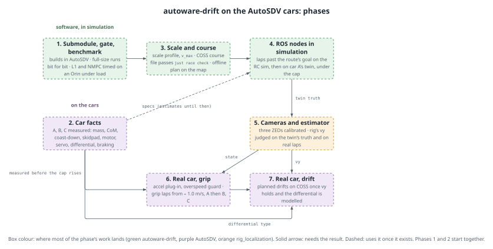

# 16. autoware-drift on the AutoSDV cars

**Status:** planned, 2026-11-12. No phase started.

**Spec:** [`docs/superpowers/specs/2026-11-12-autoware-drift-integration-design.md`](../../superpowers/specs/2026-11-12-autoware-drift-integration-design.md).
The spec is the authority; these documents break its stages into tasks and exit criteria.

**Goal:** grip laps, then planned drifts, on a closed COSS loop, on each of the real cars A,
B and C, driven by autoware-drift's race planner and C++ NMPC under a speed cap the operator
sets per test, with Autoware still in charge of map, localization, routing, operation
modes, the gate, MRM and diagnostics.

Diagrams: [on the car](../../design/assets/race-stack/architecture.svg),
[the field](../../design/assets/race-stack/field.svg),
[repositories and packages](../../design/assets/race-stack/repos.svg)
(Typst sources beside them).

## Phases

| # | phase | lands mostly in | needs | exit, in one line |
|---|---|---|---|---|
| 1 | [Submodule, regression gate, Orin benchmark](1-submodule-gate-benchmark.md) | AutoSDV, autoware-drift | — | the submodule builds without changing `just build`; full-size runs reproduce bit for bit; L1 and the NMPC timed on an Orin under load |
| 2 | [Car facts](2-car-facts.md) | AutoSDV `individual_params` | — | measured `vehicle_spec.yaml` for A, B, C, differential type known |
| 3 | [Scale and course](3-scale-and-course.md) | autoware-drift, AutoSDV | 1 | small-car profile, `v_max`, `Track.from_lanelet2`; the COSS course passes `just race check`; an offline plan on the map |
| 4 | [ROS nodes in simulation](4-ros-nodes-in-simulation.md) | autoware-drift, AutoSDV | 3 (2 when ready) | repeated laps past the route's goal on the RC sim and on car A's twin, never over the cap |
| 5 | [Cameras and estimator](5-cameras-and-estimator.md) | rig_localization, autoware-drift, AutoSDV | 4 | three ZEDs per car; vy from rig judged against the twin's truth and on real laps |
| 6 | [Real car, grip](6-real-car-grip.md) | AutoSDV | 2, 5 | grip laps on COSS from ≈ 1.0 m/s, raised in steps; A, then B and C |
| 7 | [Real car, drift](7-real-car-drift.md) | autoware-drift, AutoSDV | 2, 5, 6 | a planned drift held on COSS |

Phases 1 and 2 start together: phase 2 is bench and field measurement and needs none of
the software.

Each phase gets its own implementation plan (`superpowers:writing-plans`) when it starts,
written against what the previous phases measured. These documents fix scope, order and
the evidence that ends a phase, not the code.

## Global constraints (every phase)

From the spec's decisions and its "Existing functions do not break" table:

- **Opt-in only.** The race stack runs from `just race` recipes, a new preset or a new
  sensor suite. `autosdv.launch.yaml` gains no new defaults. `just launch`, the logging and
  planning simulations, MCL, the CUDA pipeline, Lab 2, Lab 3 and the coach behave as before.
- **`just build` without the new dependencies is today's build.** Each package that needs
  CasADi/IPOPT, acados, cuVSLAM or GTSAM skips itself when it is missing, as
  `cuda_pointcloud_filters` does without CUDA.
- **`just test` passes at the end of every phase.** New packages add their own tests.
- **The lab simulators are not touched.** `autosdv_rc_sim/vehicle.yaml` and the `sim`
  instance stay as released; the race sim passes its spec explicitly. Released lab tags
  are never moved.
- **individual_params: new files only.** Existing per-car files are unchanged.
- **Generic in autoware-drift, specific in AutoSDV.** ROS nodes, messages, the lanelet2
  course reader, the scale configuration, `v_max` and the estimator are autoware-drift's;
  car specs, the COSS course, the race launch, the vehicle interface and the safety layers
  are AutoSDV's.
- **autoware-drift's `main` behind the regression gate.** With the full-size defaults, the
  gate's runs reproduce bit for bit (`RP_DET=1`) before every push to `main`.
- **Lockstep pushes.** A submodule commit is pushed before the AutoSDV pin that names it
  (CLAUDE.md, "Submodule Workflow"). No force pushes.
- **No patches to `/opt/autoware`**, and no per-car forks of the planner: per-car facts are
  data.
- **The speed cap is never only the planner's.** From phase 4 on, every run on a car or
  twin has the gate's `vel_lim`; from phase 6 on, the vehicle interface's overspeed guard
  as well.
- **Processes:** play_launch, killed by PGID; temporary files in `./tmp`.

## Open questions carried from the spec

| question | answered in |
|---|---|
| Differential type per car (locked/spool or open) | phase 2 |
| Can the planner's brake model express rear-only braking with the measured numbers? | phase 2, then 3 |
| Does L1 fit its 1 s budget on an Orin under the race load; with which horizon? | phase 1 |
| What does Autoware do on route ARRIVED, and how is it kept from ending the race? | phase 4 |
| Why rig_localization moved from stereo to monocular (rig-odom-sim history); stereo for these cameras? | phase 5 |
| Hardware sync across the three ZEDs on the capture card | phase 5 |
| Where the front ZED's current consumers (ArUco, perception) go once three are mounted | phase 5 |
| Which COSS loop and start point | phase 3 (builder's call) |
