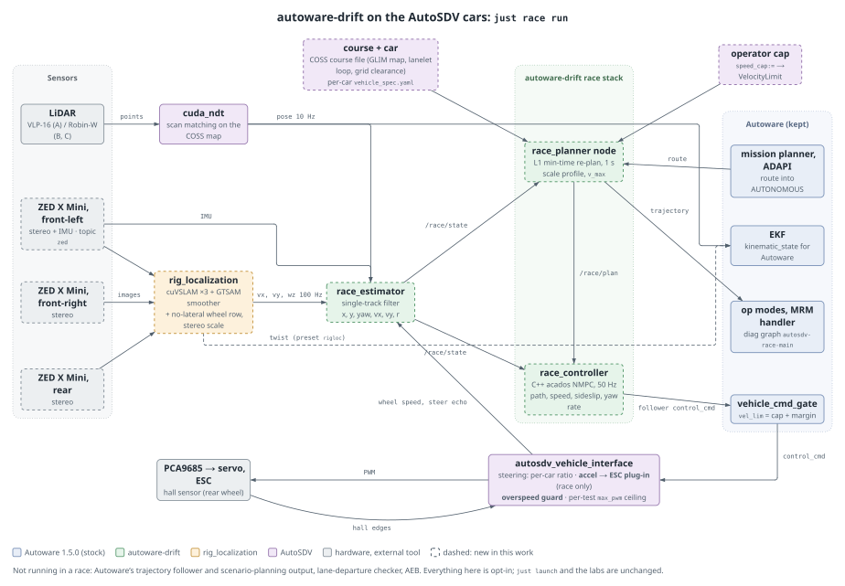
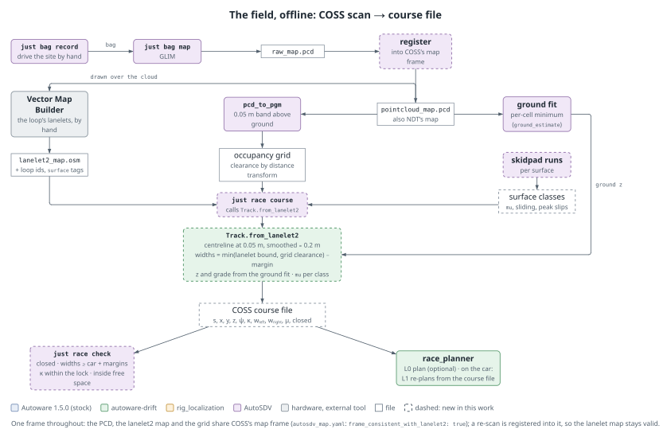
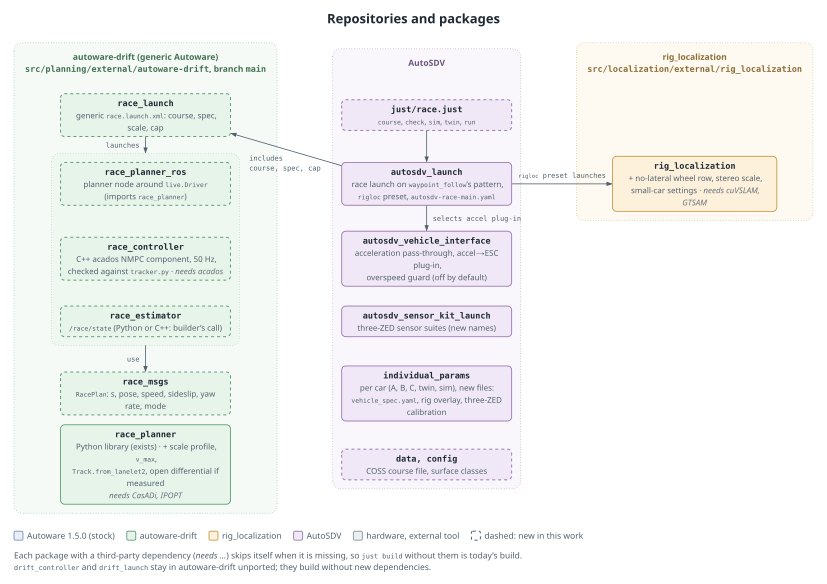

# autoware-drift on the AutoSDV cars — design

Status: approved, 2026-11-13. Phases: `docs/roadmap/16-autoware-drift/`.

## Intent

Bring [autoware-drift](https://github.com/jerry73204/autoware-drift)'s racing stack (a
minimum-time planner that chooses grip or drift, and a 50 Hz tracker that holds a planned
slide) onto the **real** AutoSDV cars A, B and C, driving outdoors on the COSS site.

autoware-drift is today a full-size-car project: a pure-Python planner (`race_planner`,
CasADi) driven through swb's Isaac course runner, with no ROS node, swb course files as its
only track input, and constants tuned to a 1450 kg car. AutoSDV has a 1/10 rear-drive
chassis, Autoware 1.5.0, NDT on a GLIM map, one rear hall sensor and no lateral-velocity
measurement. This design closes the gaps between the two.

## Decisions (user, 2026-11-12)

- **The ROS interface and packages live in autoware-drift**, generic for any Autoware
  project. AutoSDV holds only what is AutoSDV-specific: car specs, the COSS course, the
  launch that wires the race stack into AutoSDV's vehicle stack, and safety layers.
- **autoware-drift is a submodule of AutoSDV.**
- **Target: the real cars, A to C.** Simulation is a step on the way, not the goal.
- **The chassis stays as it is: rear-axle drive.** No hardware conversion.
- **Outdoors, starting on the COSS map** (`data/COSS-map-planning`).
- **A speed cap for practical testing.**
- **The race planner owns the laps.** Autoware's mission planner cannot route a closed loop
  (a route may not enter a lanelet twice; Lab 3 drives a lap as two routes with a stop).
  A route to a goal on the loop only brings the car into AUTONOMOUS; the race planner then
  follows its own course file lap after lap and does not stop at the route's goal. The
  build must check what Autoware does on arrival (route state ARRIVED, operation mode,
  anything that stops the car) and keep it from ending the race.
- **The controller is the C++ NMPC (acados) now**, as recorded in autoware-drift's
  `race-stack-design.md` (2026-10-28): a C++ ROS 2 component, the model and cost written in
  acados' Python front end, the generated C linked by the node. The Python L2 tracker
  (`tracker.py`) is its reference: same model, same references (path, speed, sideslip, yaw
  rate), and the C++ node is checked against it on recorded states.
- **autoware-drift changes land on its `main`, behind a regression gate.** With the
  full-size defaults, a fixed set of runs reproduces the current results bit for bit
  (`RP_DET=1`) before every push; the small-car profile is additive.
- **The field is modelled from a GLIM point cloud**, as the user builds maps today.

## Goals

1. Grip laps, then planned drifts, on a closed COSS loop, on each of cars A, B and C, under a
   speed cap the operator sets per test.
2. Autoware stays in charge of what it is good at — map, localization, routing, operation
   modes, the command gate, MRM, diagnostics — and the race stack replaces only the speed
   profile and the controller, on Autoware's own seams (autoware-drift's
   `docs/race-stack-design.md`).
3. Everything a general Autoware user would need (ROS nodes, a lanelet2 course reader, a
   scale configuration, a state estimator, a speed cap honouring Autoware's `VelocityLimit`)
   is in autoware-drift.

## Non-goals

- Changing the chassis (drivetrain, steering knuckles).
- `drift_controller` (autoware-drift's first approach, a drift law after the gate): its own
  docs call it superseded; it is not ported.
- The `drift_budget` and `drift_max` styles. `fastest` (grip, drifting only where it is
  faster) comes first.
- Traffic or perception in the race. Perception runs as today; the race graph does not
  depend on it.

## Anti-goals

- **A cap that only the planner enforces.** A planner bug must not be able to exceed the
  test's speed.
- **A spec that is mostly guesses driven at the limit.** Each car's mass, tyre and motor
  numbers are measured before the cap is raised past grip driving.
- **Patching Autoware** (`/opt/autoware`) or forking autoware-drift's planner per car. Per-car
  facts are data.
- **Two vehicle models that disagree.** Today `autosdv_rc_sim/vehicle.yaml` says 3.5 kg and
  the twin's `autosdv_car_a.yaml` says 5.0 kg and 4WD; the race stack must not add a third.

## Gap analysis

What `race_planner` consumes (its `serve.py` contract) against what AutoSDV provides.

### Vehicle (`sim_vehicle_spec` v2 YAML, `Car.from_spec`)

| need | AutoSDV today | fix |
|---|---|---|
| rear drive | the chassis is rear-drive; the twin spec says `drive_axle: all` | correct the spec to `rear` |
| **locked rear axle** (`axle.py` asserts `diff == "locked"` whenever tyres are modelled) | unknown: a rear-drive RC chassis usually has a ball or gear (open) differential | measure (lift the rear, turn one wheel: same direction = locked/spool, opposite = open). If open: autoware-drift gains an open-differential axle model (equal torque split, the unloaded inner wheel limits drive). This is the largest modelling item and gates drift work, not grip laps |
| mass, CoM, Iz, tyres, motor, brakes, steering rate | geometry measured; everything else estimate, literature or mock | measure per car with AutoSDV's existing tools: scale, balance point, `just sim fit-coastdown`, a skidpad run (`fit.skidpad_mu`), `just coach fit-motor`; servo rate from a step on the bench |
| full-scale tuning constants | — | see "Scale" below. Critical: `axle.py` `SMOOTH` 50 N (more than the car's weight); tyre slip offsets 4.0 / 1.0 m/s (`model.py:50`); `car.py` default wheel mass 20 kg |
| steering lock | 0.349 rad (20°) | kept. A 20° lock bounds the sideslip a drift can hold; the planner's constraint already enforces it. Expect mild slides |

**One spec per car, one place.** `individual_params/config/<car>/autosdv_vehicle/vehicle_spec.yaml`
(sim_vehicle_spec v2), each value provenance-tagged (`measured`, `estimate`) as the twin's
spec does. The twin and the RC simulator read it (the RC sim's `vehicle.yaml` becomes a
derived view or is generated); the race stack reads it. `twin` and `sim` instances get
their own copies, derived from car A's.

### State per tick (`t, x, y, yaw, vx, vy, r, delta` at the CoM, 50 Hz)

| need | AutoSDV today | fix |
|---|---|---|
| x, y, yaw | NDT (cuda_ndt) ~10 Hz, EKF at 50 Hz | kept; CoM offset from `base_link` applied by the estimator |
| vx (body) | one rear hall sensor, 20 Hz, 2.75 cm per edge — a driven wheel, so it over-reads in wheelspin and in a power slide | race estimator |
| **vy** | none: `velocity_report.lateral_velocity` is hard-coded 0, the EKF has no lateral state | **race estimator**. Without vy the planner sees no slide: its off-plan and spin triggers read sideslip |
| r | ZED X Mini gyro, ~100 Hz | kept |
| delta | command echo (`steering_status`, filtered), no sensor | acceptable: L2 uses `delta` only on its first tick; L1 takes it as the re-plan's initial state, where the filtered echo is the best estimate |

**The race estimator** (autoware-drift, generic; designed in its `race-stack-design.md`):
a single-track filter whose process model is the spec's tyre model, measuring NDT pose
(with its covariance), IMU yaw rate and specific force, the driven-wheel speed, and the
steering command. Out: `/race/state` (`nav_msgs/Odometry` with `twist.linear.y`). In simulation, until
stage 5, the state is the simulator's truth (the RC sim publishes the true pose and twist on
`/localization/kinematic_state`; the twin has Isaac's).

At 2 m/s, a 0.5 m/s lateral velocity moves the car only 5 cm between 10 Hz NDT scans,
close to NDT's noise, so vy is weakly observable from pose alone. The race estimator's vy
comes from the camera rig (next section).

### Cameras and rig_localization (user, 2026-11-12)

Each car gets **three ZED X Mini stereo cameras: front-left, front-right and rear.** They
feed [rig_localization](https://github.com/NEWSLabNTU/rig_localization) (NEWSLab's
camera-rig twist estimator: cuVSLAM on the GPU, a GTSAM fixed-lag smoother with the IMU and
the wheel speed), which is the race estimator's source of **vy**:

- its twist is base_link's (vx, vy, wz) with a covariance calibrated against NDT, at the
  IMU's rate (`fast_twist`, 100 Hz on a ZED X), stamped at capture;
- its vx comes from vision and IMU, so it does not over-read in wheelspin as the hall sensor
  does;
- three cameras covering front-left, front-right and rear keep features in view through a
  spin, where one forward camera can see only sky or a blank wall.

Autoware's EKF takes only vx and wz from a twist, so the race estimator reads rig's twist
directly; rig can also replace `gyro_odometer` as Autoware's twist source
(`twist_source:=rigloc`).

What rig_localization needs (generic changes, in its repository):

| gap | today | fix |
|---|---|---|
| the wheel factor zeroes vy | `BodyVelocityFactor` measures (longitudinal, **lateral**, 0) with a 0.1 m/s lateral sigma; AutoSDV's `VelocityReport.lateral_velocity` is a hard-coded 0, so in a slide the factor pulls vy to zero | a parameter that drops the lateral row for vehicles that do not measure it |
| the metric scale comes from the driven wheel | monocular cuVSLAM per camera, scale from the wheel; the hall sensor over-reads in wheelspin and a power slide | **stereo**: each ZED X Mini is a stereo pair, so cuVSLAM's stereo (or multi-stereo-rig) tracking gives metric scale without the wheel. rig moved from stereo to monocular on the golf cart; rig-odom-sim's history says why, and that reason is checked against these cameras before choosing. Until then: the wheel factor's existing gate tuned to reject wheelspin |
| camera slots | four fixed names, `zed` (primary, with the IMU), `left`, `right`, `rear`; the others enter as aux cameras | front-left as `zed`, front-right as `right`, rear as `rear`, with no code change; one ZED's IMU (front-left's) is the estimator's IMU |
| small, fast car | tuned on a golf cart | drift yaw rates of 2–4 rad/s, cameras 0.1–0.3 m above the ground, motion blur: measured on the twin first (Isaac's true vy), then on recorded real laps |
| start-up | 10–34 s of motion before the first twist | a warm-up lap before the race starts |
| Orin | never built or run on one | in stage 1's benchmark: cuVSLAM on three cameras, cuda_ndt and the race stack sharing the Orin |

AutoSDV side:

- the sensor kit: three ZED X Mini nodes (the ZED wrapper per camera, by serial number; depth
  off, since rig needs only images and IMU) on a GMSL2 capture card, their URDF frames, and
  each car's `sensor_kit_calibration.yaml` with the three mounts. The cameras' extrinsics to
  base_link must be calibrated, not estimated: rig's multi-camera fusion trusts them.
  Hardware sync across the three, if the capture card offers it, is to be checked;
- rig_localization as a submodule at `src/localization/external/rig_localization`
  (NEWSLabNTU, `branch = main`), the cuVSLAM fetch as a step in `setup/registry.py`, GTSAM
  through rosdep;
- a `rigloc` localization preset and a per-car rig overlay (cameras, topics, the wheel scale
  from `rigloc_wheel_calib` against NDT on COSS);
- the twin's spec and Isaac rig gain the three cameras, so rig is judged against Isaac's
  truth before the real car;
- what else uses the current front ZED (Lab 2's ArUco localization, perception presets) moves
  to one of the new cameras or keeps its own; decided when the hardware is mounted.

The optical-flow ground-speed sensor is no longer planned; it returns only if rig's vy fails
on the twin.

### Command (`accel` m/s², `tire_angle` rad)

| need | AutoSDV today | fix |
|---|---|---|
| tire angle | `Control.lateral.steering_tire_angle` → per-car measured ratio (car A −249, B −166, C +132) | kept. The actuator's fixed EMA (α 0.3) is a lag the planner does not know: model it in the spec's `steering.time_constant` or bypass it in race mode |
| longitudinal acceleration | the actuator reads only `longitudinal.velocity`; `AckermannSpeedPID` tracks wheel speed | in simulation (stage 4): the race controller sends the plan's speed as the velocity target (works for grip). On the real car (stage 6): the actuator passes `longitudinal.acceleration` to the speed-controller plug-in, and a new plug-in maps acceleration to ESC PWM with the ESC model (`docs/design/esc-pwm-model.md`) and the coast-down fit, feedback on wheel speed. Needed for drift, where the driven wheel's speed is the thing being controlled |

### Track (`Track`: s, x, y, z, psi, kappa, w_left, w_right, mu, closed)

| need | AutoSDV today | fix |
|---|---|---|
| a course | lanelet2 maps; the only course loader in autoware-drift reads swb files and one scalar half-width | `Track.from_lanelet2` in autoware-drift (see "Field model") |
| per-surface friction | none | per-surface `mu` from skidpad runs; lanelet `surface` tag → class |

### Compute

L1 re-plans within a 1 s budget across 2–5 single-threaded processes, compiled with gcc at
runtime; L2 needs ~2 ms per 50 Hz tick on x86. Nothing has been measured on a Jetson AGX
Orin. **The first task is a benchmark on an Orin**; the scale constants (horizon, re-plan
period) are set from it.

## Field model: COSS

COSS today: `data/COSS-map-planning`, 56 road lanelets, 613 m, widths p5/p50/p95
0.86 / 1.23 / 1.87 m, a ~100 × 85 m site, flat to 0.3 m; closed loops exist (the longest
directed cycle is 495 m over 41 lanelets). The car is 0.33 m wide.

1. **One frame.** The PCD, the lanelet2 map and the occupancy grid already share COSS's map
   frame (`autosdv_map.yaml`: `frame_consistent_with_lanelet2: true`). A re-scan of the site
   goes through `just bag map` (GLIM) and is registered into that frame, so the lanelet map
   stays valid.
2. **The course is a lanelet sequence.** A named loop (a list of lanelet ids, closed) in an
   AutoSDV course file. Autoware routes the same lanelets, so the mission planner and the
   race agree on where the car goes.
3. **Widths from the scan, not only the drawing.** `pcd_to_pgm.py` already makes a 0.05 m
   occupancy grid of points in a band above the ground. Its distance transform gives the
   physical clearance at each station; each side's width is the lesser of the lanelet
   bound and that clearance, less a margin. On COSS the lanelet bounds are paths between
   kerbs and vegetation; the grid also catches what the drawing missed (the 9 cm kerb step
   near (−12.6, −14.5) that `routes.yaml` notes).
4. **Grade from the scan.** z along the centreline from a ground fit of the PCD (the per-cell
   minimum `ground_estimate` already computes); grade = dz/ds. The planner uses grade as
   gravity along the road. Banking is not modelled.
5. **Surface.** One class per lanelet (`surface` tag, default the site's paving), each class's
   `mu`, `sliding` and peak slips in an AutoSDV surface-class file, from skidpad runs on that
   surface.
6. **Smoothing at RC scale.** Centreline resampled at 0.05 m, smoothed over ~0.2 m (swb uses
   0.5 m and 2 m), then psi and kappa by central differences, as swb's course generator does.

Tools: `Track.from_lanelet2(osm, lanelet_ids, grid=None, surfaces=None)` and a generic course
file writer/reader in autoware-drift; `just race course` in AutoSDV builds the COSS course
file; `just race check` verifies it (closed, widths ≥ car width + margins, curvature within
the car's lock, every station inside the grid's free space), as `lab3 check-lanelet` does
for Lab 3.

## Scale

autoware-drift gains a scale configuration (one YAML, loaded by every module) in place of
its full-size literals (~40, listed in its code by module). The defaults stay the
full-size values; AutoSDV ships a small-car profile. Starting point by Froude scaling from
the wheelbase (0.319 / 2.886 ≈ 0.11): lengths × 0.11, speeds and times × 0.33,
accelerations × 1. Times are then bounded by what the Orin benchmark allows. The bundled
data fitted to drift_mustang (`corner_library.npz`, `drift_map.json`, `drift_losses.json`)
are off for the small car until rebuilt for it.

## Speed cap

Four layers; the lower two are hard (they hold if the planner misbehaves).

| layer | where | what |
|---|---|---|
| planner | autoware-drift | a `v_max` parameter bounding vx in L1's window, clamping the L0/QSS ceiling and the tracker; the planner node also honours Autoware's `VelocityLimit` on `/planning/scenario_planning/max_velocity_default`, as AutoSDV's drive tool and `twin_go` publish it |
| command gate | AutoSDV race launch | `vel_lim` = cap + margin (today 25 m/s, effectively open) |
| vehicle interface | AutoSDV | **new** overspeed guard: wheel speed above cap + margin → coast, then brake, with a diagnostic. Wheel speed over-reads in a slide, so it errs safe. Plus a per-test `max_pwm` override (today 470 on every car) as a physical throttle ceiling |
| diagnostics | AutoSDV race graph | overspeed, leaving the course corridor, and a spin (sideslip/yaw rate outside the recoverable envelope, from the race controller) are MRM faults |

One operator knob, `speed_cap:=` on the race launch, sets all four.

## Target architecture

Three diagrams, written in Typst (fletcher) and rendered to SVG beside their sources in
`docs/design/assets/race-stack/`. Box colour names the repository that owns the part;
a dashed border marks what this work builds. Re-render after an edit with
`typst compile --format svg <name>.typ` in that directory (`style.typ` holds the shared
colours and node shapes).

### On the car, `just race run` (new; nothing else launches it)

Source: `architecture.typ`.

- The race estimator fuses NDT's pose, rig_localization's twist (vx, vy, wz), the front-left
  ZED's IMU, the hall-sensor wheel speed and the steering echo into `/race/state`.
- The planner node re-plans (L1, 1 s) from the course file and the car's spec, bounded by
  `v_max` and Autoware's `VelocityLimit`. It publishes `/race/plan` to the controller and
  Autoware's trajectory to the gate and validators.
- The C++ NMPC publishes on the trajectory follower's topic
  (`/control/trajectory_follower/control_cmd`), so the gate, operation modes and MRM
  handle it as they would Autoware's follower.
- Autoware keeps routing (only to bring the car into AUTONOMOUS), the EKF for its own
  consumers, operation modes, MRM with the `autosdv-race-main` graph, and the gate.
- Not running in a race: Autoware's scenario-planning output and trajectory follower
  (`launch_trajectory_follower:=false`), the lane-departure checker, AEB. Perception may be
  off; the race graph does not read it.

### Offline: the field

Source: `field.typ`. The steps are those of "Field model: COSS" above.

### Repositories and packages

Source: `repos.typ`. "Where things go" below lists the same parts in words.

## Existing functions do not break (user, 2026-11-12)

Everything above is **opt-in**: it runs only from the new `just race` recipes, a new
preset, or a new sensor suite. Defaults stay as they are.

| existing function | risk | rule |
|---|---|---|
| `just build` everywhere (students, CI, amd64 without a GPU) | rig_localization fails to configure without cuVSLAM (`FATAL_ERROR`); the NMPC needs acados; the planner needs CasADi | each skips itself when its dependency is missing, as `cuda_pointcloud_filters` does without CUDA; a build with none of them is the same as today's. autoware-drift's `drift_controller` / `drift_launch` build harmlessly (pure Python, no new dependencies) |
| `just launch`, logging sim, planning sim, MCL, CUDA pipeline | — | `autosdv.launch.yaml` gains no new defaults; `twist_source` gains a `rigloc` value, `gyro_odom` stays the default |
| vehicle interface on every car | the actuator change | the acceleration pass-through is unused unless the race plug-in is selected; `AckermannSpeedPID` and its tests unchanged; the overspeed guard is off by default (`max_speed: 0`) |
| Lab 2 (Part 1 grader, Part 2 on cars), Lab 3, coach | RC sim model, `sim` instance, front ZED | `autosdv_rc_sim/vehicle.yaml` and the `sim` instance unchanged; the race sim passes its spec explicitly. Released lab tags are never moved |
| ArUco localization, perception presets | the front ZED's topic and frame | the front-left camera keeps the `zed` topic and frame names, so its consumers keep working; the new suites add `front_right` and `rear` namespaces. A car's preset changes suite only when its hardware is mounted and calibrated, and the ArUco/perception mounts are re-checked then |
| sensor suites `vlp16_zed`, `robin_zed`, ... | — | unchanged; three-camera suites are new names |
| individual_params per car | — | new files only; existing files unchanged |
| the twin | spec correction `drive_axle: all` → rear | a deliberate behaviour change (it was wrong); the twin's existing checks are re-run after it |
| `just test` | — | the existing suite passes at every stage; the new packages add their own tests |

## Where things go

**autoware-drift** (generic):
- `race_msgs` (`RacePlan`: per point s, pose, speed, sideslip, yaw rate, mode);
- a planner node wrapping `live.Driver` (L1 re-plans; publishes
  `/planning/scenario_planning/trajectory` and `/race/plan`);
- the C++ NMPC controller component (acados; publishes
  `/control/trajectory_follower/control_cmd`), checked against `tracker.py`;
- the race estimator node (`/race/state`);
- `Track.from_lanelet2`, the course file format, the scale configuration, `v_max`;
- an open-differential axle model, if the measurement calls for it;
- a generic `race.launch.xml` taking the course, spec, scale and cap;
- the swb dependency made optional (tests and the sim plant only).

**AutoSDV**:
- the submodule at `src/planning/external/autoware-drift`, `branch = main`;
- per-car `vehicle_spec.yaml` in `individual_params` (car_a, car_b, car_c, twin, sim);
- the surface-class file and the COSS course file;
- the vehicle interface's acceleration pass-through, acceleration plug-in and overspeed
  guard;
- a race launch built like `waypoint_follow.launch.xml`: AutoSDV's vehicle stack, the gate,
  operation modes, MRM, `launch_trajectory_follower:=false`, the race nodes, and an
  `autosdv-race-main.yaml` diagnostic graph;
- a `just race` module (`course`, `check`, `sim`, `twin`, `run`).

## Stages

Each stage ends with something driven and measured. The phase documents,
`docs/roadmap/16-autoware-drift/`, break each into tasks with exit criteria; their
dependency graph is `docs/design/assets/race-stack/stages.svg`.

1. **Submodule, regression gate and benchmark.** The submodule builds in AutoSDV; the
   full-size regression set is recorded; the planner runs headless on an Orin against its
   own plant with a small-car spec, under the race launch's load; L1 timing recorded, and the
   acados NMPC's solve time from a first generated model.
2. **Car facts.** Per-car specs measured (mass, CoM, coast-down, skidpad, motor, servo rate,
   differential type) for A, B, C; twin and RC sim read them.
3. **Scale and course.** Scale config and `v_max` in autoware-drift; `Track.from_lanelet2`;
   the COSS loop's course file; the planner's offline plan around it, plotted on the map.
4. **ROS nodes in simulation.** Planner node and C++ NMPC controller; lap handling past the
   route's goal; the AutoSDV race launch on the RC simulator (the simulator's true state),
   then on car A's twin on the COSS Isaac world.
5. **Estimator.** The three cameras mounted and calibrated; rig_localization's lateral
   option and stereo scale; the race estimator (NDT pose, rig's twist, IMU, wheel, steering)
   judged against the twin's truth and on recorded real laps.
6. **Real car, grip.** Acceleration plug-in and overspeed guard; grip laps on COSS at a low
   cap (start ~1.0 m/s), raised in steps, car A first, then B and C.
7. **Real car, drift.** Once the estimator holds vy on real laps and the differential is
   modelled.

## Calls made in writing this (not the user's; check them)

- **The lab simulators are not touched.** Lab 2 Part 1's grader and Lab 3's `sim_lap.py`
  run on `autosdv_rc_sim/vehicle.yaml` and the `sim` instance; changing either mid-course
  changes graded results. The per-car specs are new files; the RC simulator reads one only
  when the race launch passes it, and the lab default stays as released. Folding the
  simulator onto the per-car specs waits for the semester's end.
- **Brakes are rear-only.** The ESC brakes the rear axle through the motor (`brake_pwm`);
  there are no front brakes and no regen control. Each spec says so (`brakes.distribution`
  all rear, `regen_*` zero), and the car-facts stage measures braking deceleration from a
  set of speeds per car. If the planner's brake model cannot express rear-only braking with
  the measured numbers, that is a second modelling item beside the differential.
- **The Orin benchmark runs under the race launch's real load** (localization, the vehicle
  stack, the race nodes), not the planner alone. If L1 does not fit its budget, the order of
  fallbacks is: perception off for races (the race graph does not need it), then a longer
  re-plan period and shorter horizon until laps degrade measurably. Running L1 off the car
  is out of scope.

## Left to the builder

- Which COSS loop (the 495 m cycle or a shorter sub-loop) and its start point.
- File and package names inside autoware-drift, following its conventions.
- Whether the race estimator is Python or C++ (the controller is C++; the estimator is not
  decided).
- The overspeed guard's margin and brake profile, within the vehicle interface's existing
  longitudinal shell.
